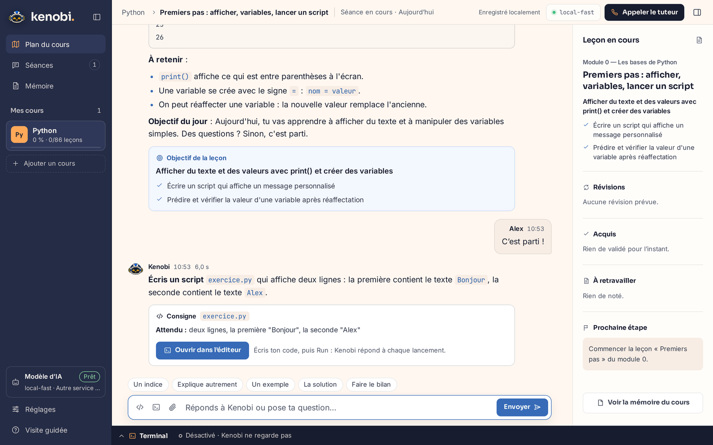
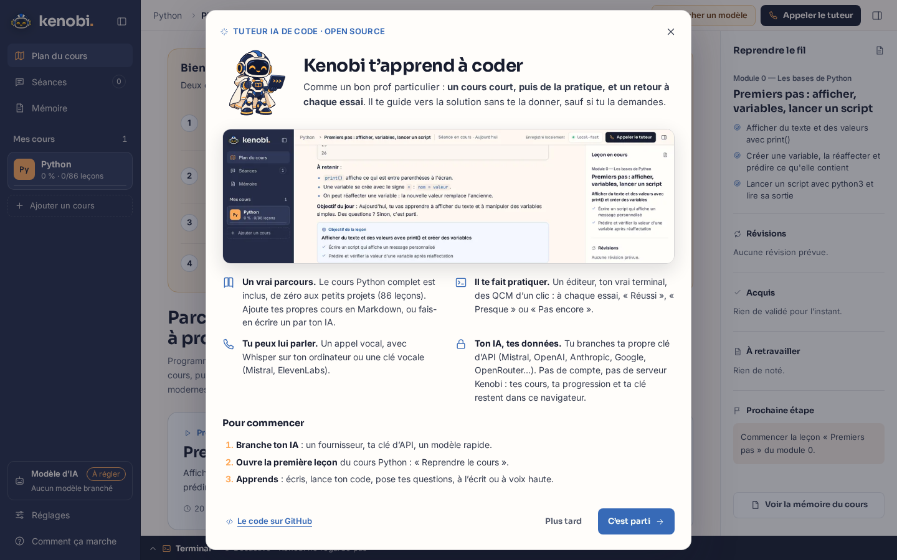
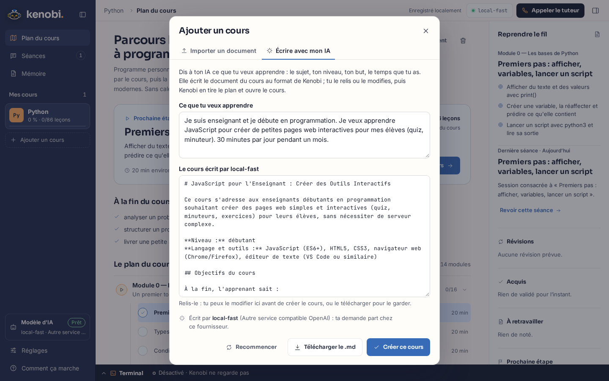

<p align="center">
  
</p>

<h1 align="center">Kenobi — your AI coding tutor</h1>

<p align="center">
  A patient tutor for programming and computer science that runs in your browser, with the AI model of your choice.<br>
  <strong><a href="https://lecagibi.ch/Kenobi-tutor-IA/">Open Kenobi</a></strong> ·
  <a href="https://motmot3000.github.io/Kenobi-tutor-IA/">mirror on GitHub Pages</a> ·
  <a href="#run-it-yourself">run it yourself</a> ·
  <a href="CONTRIBUTING.md">contribute</a>
</p>

<p align="center">
  
</p>

Kenobi teaches you to code the way a good human tutor would: a short lesson first, then practice. Every time you run
your code, it tells you **« Réussi »** (done), **« Presque »** (almost) or **« Pas encore »** (not yet), without giving
away the answer. Hints and solutions come only when you ask. It remembers what you know and what needs review, and
brings old topics back with spaced repetition.

You bring the AI: paste an API key from Mistral, OpenAI, Anthropic, Google, OpenRouter, DeepSeek or Groq, or use a
model running on your own computer (Ollama, LM Studio…). There is no Kenobi account and no Kenobi server: your key
and your progress stay in your browser.

> **Language.** The interface and the tutor speak **French** today. Translations are very welcome: see
> [CONTRIBUTING.md](CONTRIBUTING.md#translations).

## What you get

- **A full Python course to start from zero**: 14 modules, 86 lessons with goals and durations, from the first
  `print` to small web projects. Add your own courses from a Markdown document, or describe what you want to learn
  and let your AI write the course for you.
- **A tutor with a method**: a short lesson to open each topic, one-click answers (multiple-choice questions and
  answer buttons), feedback on every attempt, hints only on request, a lesson contract with clear success criteria,
  and a recap when you have proven the skill on a new task.
- **A real terminal**: an editor with a Run button next to your computer's own terminal. Kenobi sees what you run
  (if you want it to) and answers each attempt. Python, JavaScript (Node.js), shell and Git, and more.
- **A voice call**: talk to Kenobi and hear it answer, with an animated mascot that listens, thinks and speaks.
  Free and private with Whisper on your computer, or with a Mistral (Voxtral) or ElevenLabs API key.
- **A memory per course**: what you have learned, what is fragile, reviews due, the thread of your sessions.
  Exportable as Markdown, never locked in.
- **Your data stays yours**: in the web version everything lives in your browser (IndexedDB); keys are encrypted
  with Web Crypto and only sent to the provider you chose. Export a backup whenever you like.

## Start in two minutes

1. Open **[Kenobi](https://lecagibi.ch/Kenobi-tutor-IA/)**. A welcome screen explains what it does; « C'est parti »
   starts a short guided tour.
2. **Connect your AI**: the tour ends there (or click « Brancher un modèle », top right): choose a provider, paste
   your API key, pick a model, « Enregistrer et tester ». A fast, inexpensive model is enough.
3. The « Bien démarrer » card leads you to the first lesson of the Python course: Kenobi starts with a short lesson,
   then makes you practise.

<p align="center">
  
</p>

| Provider | Get a key | Works from the browser |
|---|---|---|
| Mistral | <https://console.mistral.ai/api-keys> | yes |
| OpenAI | <https://platform.openai.com/api-keys> | yes |
| Anthropic (Claude) | <https://console.anthropic.com/settings/keys> | yes |
| Google (Gemini) | <https://aistudio.google.com/apikey> | yes |
| OpenRouter | <https://openrouter.ai/keys> | yes |
| DeepSeek | <https://platform.deepseek.com/api_keys> | yes |
| Groq | <https://console.groq.com/keys> | yes |
| Ollama, LM Studio, llama.cpp, any OpenAI-compatible server | your own address | yes, if it allows the page's origin (CORS)¹ |

¹ For Ollama: `OLLAMA_ORIGINS=https://lecagibi.ch ollama serve` (use the address where you open Kenobi).

Tip: create a **dedicated key with a spending limit** for Kenobi. You can revoke it at any time.

### Talk to Kenobi (optional)

Settings › Voix offers two ways to give Kenobi ears and a voice:

- **Whisper on your computer — free and private.** Download the small voice bridge `kenobi-voice.py` from the
  settings, run `python3 kenobi-voice.py` (Python 3.8+). The first run installs Whisper (speech recognition) and
  Piper (speech synthesis), about 1.1 GB, then prints a pairing code: paste it in Kenobi. Your voice never leaves
  your computer. Details: [docs/voice.md](docs/voice.md).
- **A voice API key** — Mistral (Voxtral) or ElevenLabs: paste the key, pick a voice, done.

### Plug your terminal (optional)

Open the « Terminal » bar at the bottom › « Brancher ce terminal »: download `kenobi-terminal.py`, run it with
`python3`, and paste the code it shows. Your editor's Run button and your real terminal are then in the page.
Kenobi never types anything in your terminal. Details: [docs/terminal.md](docs/terminal.md).

## How it works

Kenobi is a vanilla HTML/CSS/JavaScript application with no build step and no dependency to install. The same
interface runs in two ways:

```text
                 ┌───────────────────────── your browser ─────────────────────────┐
  Web version    │  interface  ──►  browser/backend.js (the API, in the page)     │──► AI provider (your key)
  (static site)  │                  IndexedDB: courses, sessions, memory          │──► voice provider, or
                 │                  vault: keys encrypted with Web Crypto         │    kenobi-voice.py (Whisper)
                 └────────────────────────────────────────────────────────────────┘──► kenobi-terminal.py

                 ┌──────── browser ────────┐      ┌──── server.py (Python, stdlib) ────┐
  Self-hosted    │  interface              │ ───► │  same API, keys in a 0600 file,     │──► AI / voice providers
  (server.py)    └─────────────────────────┘      │  progress in data/runtime/          │
                                                  └─────────────────────────────────────┘
```

- `config.js` tells the page which version runs. Served as a plain file, it says `browser`; `server.py` answers it
  with `server`.
- In the web version, `browser/backend.js` answers the same `api/…` routes as `server.py`, by wrapping `fetch`. The
  tutor (`browser/tutor.js`), the providers, the course import, the memory and the voice call are JavaScript ports of
  the Python modules, and **parity tests** check that both versions build the same prompts and data.
- The tutor's texts (its persona, method and block protocol) live in `tutor.py`. `scripts/build_browser.py` copies
  them, with the other shared constants, into `browser/shared.js`.

Read more in [docs/architecture.md](docs/architecture.md).

## Run it yourself

**The web version on your computer** (no Python package, nothing to install):

```bash
git clone https://github.com/motmot3000/Kenobi-tutor-IA.git
cd Kenobi-tutor-IA
python3 -m http.server 8000      # then open http://localhost:8000
```

**The self-hosted version** (keys and progress on the computer that runs it, usable from your local network):

```bash
python3 server.py                # http://127.0.0.1:8192 — Python 3.8+, standard library only
```

Then optionally `python3 terminal_bridge.py --service` for the terminal, and `python3 scripts/installer_voix.py`
for the local voice. Settings can only be changed from the computer that runs the server. Environment variables,
services, HTTPS and the voice gateway for outside call apps: [docs/self-hosting.md](docs/self-hosting.md).

## Add a course

A course is a Markdown document: a title, goals, `##` modules and `###` lessons. Rail › « Ajouter un cours »:

- **import a document**: drop the file; the connected AI reads it and builds the plan (modules, lessons, goals,
  durations, tools). Without AI the plan comes from the headings. The dialog explains the format and offers a
  template;
- **write it with your AI**: say what you want to learn (topic, level, goal, time); your AI writes the course in
  Kenobi's format, you read or edit it, then Kenobi imports it;
- **or with any other AI**: copy the ready-made instructions from the dialog into ChatGPT, Claude, Le Chat…, and
  import the document it writes.

<p align="center">
  
</p>

Details: [docs/courses.md](docs/courses.md).

The official course library is coming. Until then, the [`courses/`](courses/) folder collects ready-to-import
courses: **share yours with a pull request**.

## Privacy and security

- No account, no analytics, no third-party script, no Kenobi server in the web version. The page's Content Security
  Policy forbids inline and third-party scripts.
- Your API keys are encrypted in the browser (AES-GCM, with a non-extractable key or a passphrase of your choice)
  or kept for the current visit only, and sent only to the provider they belong to.
- What you write, your code and, with a voice API, your voice are sent to the providers you chose, and nowhere else.
- The terminal and voice bridges listen on `127.0.0.1` only and require a pairing code.

Details and how to report a vulnerability: [SECURITY.md](SECURITY.md).

## Project layout

| Path | What it is |
|---|---|
| `index.html`, `styles.css`, `app.js`, `core.js`, `settings.js`, `call.js`, `terminal.js`, `editor.js`, `tour.js` | The interface |
| `browser/` | The web version's backend: API routes in the page, storage, vault, tutor, providers, voice |
| `server.py`, `tutor.py`, `providers.py`, `courses.py`, `memory.py`, `settings.py`, `voice.py`, `gateway.py` | The self-hosted server (Python standard library) |
| `terminal_bridge.py` | The terminal bridge (downloaded as `kenobi-terminal.py`) |
| `voice_bridge.py` | The local voice bridge (downloaded as `kenobi-voice.py`) |
| `data/` | The built-in Python course (`default-state.json`, `plan-formation-python.md`) |
| `courses/` | Community course library |
| `docs/` | Documentation |
| `tests/` | Python and Node tests, including the parity tests between both versions |

## Development

```bash
python3 scripts/build_browser.py                                   # after changing tutor.py, settings.py, voice.py…
PYTHONDONTWRITEBYTECODE=1 python3 -m unittest discover -s tests -p 'test_*.py'
node --test tests/*.test.js
```

No test calls a real service: a fake AI provider and fake voices answer. See [CONTRIBUTING.md](CONTRIBUTING.md).

## Roadmap

- English interface and tutor, then more languages.
- The official course library, with one-click import.
- Lesson and memory editing in the interface.
- A Progressive Web App for offline reading.

## License

Kenobi is released under the [MIT License](LICENSE). It bundles [xterm.js](https://xtermjs.org) (MIT),
[TourGuide JS](https://github.com/sjmc11/tourguide-js) (MIT) and the Inter, Sora and JetBrains Mono fonts (SIL Open
Font License). The local voice installs [faster-whisper](https://github.com/SYSTRAN/faster-whisper) (MIT) and
[Piper](https://github.com/OHF-Voice/piper1-gpl) (GPL-3.0) on your computer, with their own model licenses.
